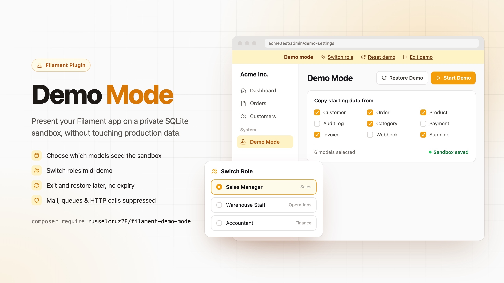

# Filament Demo Mode

<div class="filament-hidden">



</div>

A Laravel 12 and 13 / Filament 4 and 5 plugin for persistent demo sandboxes and a
separate role switcher. Select starting data, present workflows, exit, and
restore the same sandbox later without expiry. Sandboxes use the same database
engine as your application (PostgreSQL, MySQL/MariaDB or SQLite), so migrations,
stored procedures and dialect-specific SQL keep working.

[](https://packagist.org/packages/russelcruz28/filament-demo-mode)
[](https://github.com/Russelcruz28/filament-demo-mode/actions/workflows/tests.yml)
[](LICENSE)

## Installation

Requires PHP 8.2+ (8.3+ for Laravel 13), Laravel 12 or 13, Filament 4 or 5 and an Eloquent authenticatable
user. The PDO extension for your database is needed; PDO SQLite only for SQLite sandboxes.

Filament 4 uses Livewire 3; Filament 5 uses Livewire 4. The same plugin
registration and configuration work with both versions.

```sh
composer require russelcruz28/filament-demo-mode:^0.1
php artisan demo-mode:install --migrate
```

The provider is auto-discovered. Installation publishes configuration without
overwriting an existing file. New installs get `sandbox.driver = auto` (same engine
as the source); the package default stays `sqlite` so existing installs are unchanged. `--migrate` runs only the package settings migration;
omit it to manage migrations through your normal deployment process.

Register on your management panel:

```php
use DemoMode\DemoModePlugin;

->plugins([DemoModePlugin::make()])
```

With Spatie Laravel Permission, the default adapter authorizes `super_admin`,
discovers roles and permission tables, and applies one selected role at a time
to the copied presenter. Production assignments are unchanged. Adjust
`authorized_roles` and `role_guard` in `config/demo-mode.php` as needed.

Without Spatie, provide your own authorization policy:

```php
DemoModePlugin::make()->authorizeUsing(fn ($user) => $user->is_admin)
```

Authorization denies access by default. Without a role integration the switcher
offers Dashboard. Run `php artisan demo-mode:doctor`, open **Demo Mode**, save
your model selection and start. The plugin owns `/demo-mode/roles`; your existing
role chooser needs no changes.

## Demo Users

1. Tag accounts under **Demo Mode → Demo users** (for example a prospect, trainer or
   reviewer account) and choose the starting data.
2. Click **Start Demo**. The copy is prepared in a progress modal on the same page;
   when it finishes the demo is live and you stay on production. Nobody is redirected.
3. Tagged users who sign in now work in that demo.

The **Demo Mode** page shows whether a demo is live. **Reset Demo** replaces it with a
fresh copy (demo users move to it when it is ready), **Stop Demo** deletes it and signs
demo users out, and **Open Demo** lets you look around inside it as a presenter.
Set `enter_on_start` to `true` to enter the demo yourself after starting, as in 0.1.

A tagged user who signs in always works in the live demo:

- Every web request runs in the sandbox, on any panel or route; production data is never served.
- They keep the roles their account has in the copy; role switching, Reset and Exit are
  unavailable. The banner offers **Sign out**.
- They join the live demo and follow it after a Reset. Several demo users share it.
- If no demo is live, or the account was created after the demo was prepared, they are
  signed out with an explanation. Reset the demo to include new accounts.
- Users who can manage Demo Mode are never forced in, so nobody can lock themselves out.

Tag by rule instead of (or as well as) by selection:

```php
DemoModePlugin::make()->demoUsersUsing(fn ($user) => $user->hasRole('prospect'))
```

Run `php artisan migrate` after upgrading (adds `demo_settings.users`). Set
`demo_users.enabled` to `false` to turn the feature off; `demo_users.search_columns`
controls the user search in the form. API routes outside the `web` middleware group
are not redirected, so do not issue API tokens to demo users.

## Knowing Whether You Are in the Demo

Panels show a bar across the top of every page:

- **In the demo** (amber): "Demo mode — you are using a practice copy. Changes here do not
  affect real data", with Sign out for demo users or Switch role / Reset / Exit for presenters.
  A **Demo** badge sits next to the user menu (visible while scrolling) and the browser tab
  title starts with `[Demo]`.
- **Just changed** (shown once on the next page): entering the demo, the demo being reset,
  and, back on live data (blue), leaving the demo, demo access being removed, or the demo
  being stopped.

Set `notices` to `false` to keep the permanent bar but skip the one-time messages. Pages
outside Filament panels can use `@demomode … @enddemomode` to show their own indicator.

## Custom Role Systems

Callbacks run against the sandbox user, except authorization, which checks the
production user:

```php
DemoModePlugin::make()
    ->authorizeUsing(fn ($user) => $user->is_admin)
    ->prepareUsing(function ($user): void {
        // Create sandbox-only memberships required by your application.
    })
    ->rolesUsing(fn ($user) => [
        ['id' => 'sales-manager', 'label' => 'Sales Manager',
            'group' => 'Sales', 'selected' => session('demo_role') === 'sales-manager'],
    ])
    ->switchRoleUsing(function ($user, string $id): string {
        session(['demo_role' => $id]);
        // Apply the selected role through your sandbox role service.
        return '/admin';
    })
    ->synchronizeRoleUsing(function ($user): void {
        // Reapply the selected role on subsequent demo requests.
    })
    ->exitUsing(fn () => '/admin');
```

Submitted roles must exist in `rolesUsing()` before the switch callback runs.
Callbacks must enforce application-specific team/tenant rules. Include custom
context keys in `session_keys` and supporting tables in `required_tables`.
Tenant panels require an explicit integration; their policies cannot be inferred.

Complex applications can implement `ApplicationAdapter` and `RoleSwitcher` in
`DemoMode\Contracts`, then use `->adapter(YourAdapter::class)` or configure
`adapter`. Optionally implement `RequiredTables` to discover dependency tables.
Application-specific models and policies remain in your adapter, not in this
package.

Use exactly one management panel. Register
`DemoModePlugin::make()->management(false)` on other panels to retain middleware
without adding another resource or replacing management configuration.

## Sandbox Drivers

| Driver | Container | Default for | Needs |
|---|---|---|---|
| `sqlite` | `<root>/<uuid>/database.sqlite` | SQLite apps; portable mode for others | `pdo_sqlite` |
| `pgsql-schema` | `CREATE SCHEMA demo_<hash>` in the source database | PostgreSQL | `CREATE` on the database; a dedicated role (below) |
| `pgsql-database` | `CREATE DATABASE demo_<hash>`, optionally on another server | — | `CREATEDB` |
| `mysql-database` | `CREATE DATABASE demo_<hash>`, or a pool of pre-created databases | MySQL / MariaDB | `CREATE`/`DROP`, or `sandbox.pool` |

Set `sandbox.driver` (or `DEMO_MODE_DRIVER`) to `auto` to follow the source engine
(`sqlite`, `pgsql` → `pgsql-schema`, `mysql`/`mariadb` → `mysql-database`, anything
else → `sqlite` portable mode). Custom drivers implement `DemoMode\Contracts\SandboxDriver`:

```php
DemoModePlugin::make()->sandboxDriver(MyDriver::class)
```

Provisioning runs `prepare → schema → strip → copy → finalize → verify`. Foreign keys
are dropped before the copy and re-added afterwards (re-adding validates every
copied row); PostgreSQL user triggers are disabled during the copy, MySQL triggers
are dropped and recreated; sequences and auto-increments continue after the copied
keys. Same-server sandboxes copy with `INSERT … SELECT` (no rows through PHP);
`pgsql-database` streams with `COPY`. Tables page by primary key, including
composite keys.

### Schema sources

| `sandbox.schema` | How | Use when |
|---|---|---|
| `migrations` (default) | `migrate --database=demo` | Migration history reproduces the real schema |
| `dump` | Loads `database/schema/{source}-schema.sql` (`php artisan schema:dump`), then newer migrations | History has drifted. Not for `pgsql-schema`: dumps are schema-qualified |
| `clone` | Recreates the live structure: catalog for PostgreSQL schemas, `SHOW CREATE` for MySQL, `VACUUM INTO` for SQLite | History has drifted and no CLI tools are available |

`clone` refuses functions and routines whose bodies name the production schema or
database (`public.table`) or pin their own `search_path`, because the copy would run
against production. Use unqualified names in function bodies.

Source columns missing from the sandbox fail provisioning instead of being dropped
silently; set `sandbox.on_column_mismatch` to `warn` to copy the rest and show a warning.

### PostgreSQL: dedicated sandbox role

A schema sandbox keeps extension schemas (usually `public`) on its `search_path`, so an
unqualified table missing from the sandbox would resolve to production. Provisioning
creates every source table in the sandbox, and a dedicated role makes any remaining
fall-through fail instead of leak:

```sql
CREATE ROLE demo_sandbox LOGIN PASSWORD '...';
GRANT CREATE ON DATABASE app TO demo_sandbox;   -- creates and owns demo_* schemas
GRANT USAGE ON SCHEMA public TO demo_sandbox;   -- extension types and operators only
-- no table privileges on public
```

```php
// config/database.php: a copy of the pgsql connection using the role
'pgsql_demo' => [...$pgsql, 'username' => 'demo_sandbox', 'password' => env('DEMO_DB_PASSWORD')],
// config/demo-mode.php
'sandbox' => ['driver' => 'pgsql-schema', 'connection' => 'pgsql_demo', 'search_path' => ['public']],
```

Without a dedicated role, `pgsql-schema` runs with a doctor warning outside
production and refuses to start in production (`sandbox.require_dedicated_role`).

## Connections and Runtime

While a demo is active, connections that point at the source database (same driver,
host, port and database) resolve to the sandbox, so `DB::connection('pgsql')` and
migrations that name their connection (Telescope) work. Other connections are blocked
unless listed in `connections.allow`; `connections.sandbox` forces an alias and
`connections.policy = block` disables automatic aliasing.

- `runtime.cache`: `file` (per-sandbox directory) or `prefix` (your cache store with a
  `demo:<token>:` prefix, keeping Redis tags).
- `runtime.queue`: `fake` (jobs dropped) or `sync` (jobs run inline in the sandbox).
- `runtime.pause`: Telescope and Pulse stop recording during demo requests.
- `sandbox_bindings`: container swaps applied during demo requests, e.g.
  `[WebPushService::class => NullWebPush::class]`.
- `DemoMode::active()` and `@demomode … @else … @enddemomode` let the application
  adapt its behaviour.

### Multiple app servers

Server-side sandboxes are shared by every app server; their metadata and lock must
be too. Set `metadata = database` (the `demo_sandboxes` table) and `lock = cache`
(shared store) or `database` (PostgreSQL advisory lock / MySQL `GET_LOCK`; not with
PgBouncer transaction pooling). The per-sandbox directory under `root` still holds
uploads and file cache, so use shared storage or sticky sessions.

## Configuration

- `models`: explicit Eloquent class list; otherwise recursive discovery under
  `model_path` / `model_namespace`. Explicit-connection models are omitted.
- `required_tables`: always-copy tables; user/auth tables and foreign-key parents
  are discovered automatically. Unselected tables start empty but stay writable.
- `session_keys`: prefixes of context keys saved/restored across mode transitions.
  Include application carts, role selections and team context where needed.
- `sandbox_config` / `sandbox_cache`: application-specific overrides and private
  cache markers, such as disabling an external event publisher.
- `root`: private writable storage, optionally set using `DEMO_MODE_ROOT`.
- `enabled`: disable starting/restoring without deleting the saved database.
- `provisioning.chunk_size` / `provisioning.step_seconds`: rows copied per batch
  and time spent per progress request (defaults 1000 rows, 5 seconds). Keep the
  step well below your PHP and proxy timeouts.
- `sandbox.*`, `connections.*`, `runtime.*`, `sandbox_bindings`, `metadata`, `lock`:
  see [Sandbox Drivers](#sandbox-drivers) and [Connections and Runtime](#connections-and-runtime).

## Doctor

`php artisan demo-mode:doctor` resolves the driver, schema source and connection
policies; checks privileges, CLI tools and the dedicated role; scans migrations for
connection overrides, schema-qualified DDL and SQL in another dialect; and lists
external SDK clients not covered by `sandbox_bindings`. It exits non-zero when the
configuration cannot work. `--provision` builds a throwaway sandbox (one chunk per
table), reports column mismatches and relationship problems, then drops it.

## Persistence

One current (live) sandbox is retained per installation. Start publishes it without
moving the starter into it; Open Demo enters it as a presenter, and Exit preserves its
database, uploads and context. Open Demo requires the same authorized owner and works
after logout or browser-session loss. There is no expiry or scheduled cleanup; Stop Demo
deletes it. Successful Start/Reset replaces the live sandbox, including copies used by
other browsers and demo users. Failed provisioning preserves the previous copy. A Reset
started from inside the demo (banner or recovery page) moves the presenter to the new copy.

Start/Reset shows a progress modal on the current panel page that copies tables in
resumable batches, one
short request at a time, so large datasets do not hit request timeouts. The modal resumes
on any panel page if you navigate away. You
can cancel while copying; cancelled or failed copies are discarded.

SQLite sandboxes live in `<root>/<uuid>/database.sqlite`; server-side sandboxes in a
`demo_<hash>` schema or database. Each sandbox also has `<root>/<uuid>/` for uploads
and cache. Private `current.json` metadata (or the `demo_sandboxes` table) identifies
the owner and saved context. Never expose the root directory publicly.
`demo-mode:prune` removes obsolete sandbox directories and containers.

## Isolation Boundaries

Laravel database operations switch to the sandbox; connections to the source
database are aliased to it and other connections are blocked during active runtime. Disks, cache and supported Redis operations are
redirected. Mail, queued jobs and external notification channels are suppressed.
Laravel HTTP requests reject stray calls. Production login and session persistence
still use the source database outside active demo runtime. Livewire mode tokens
reject stale submissions.

This is **application-level isolation, not a security boundary**. Raw PDO,
external SDKs, direct file calls, SQL dialect-specific queries, cached service
instances, non-web APIs and application policies need explicit review. Long-lived
workers such as Octane have not been validated. See [Security](SECURITY.md).
Copied data is not anonymized. Production attachments are not copied. Workflows
requiring external services need `sandbox_bindings` replacements. Copying
large datasets still takes time and disk space, so select only the models a demo
needs.

### Not suitable if…

- Your application talks to the database outside Laravel's connections (raw PDO,
  `pg_*` functions, a second ORM).
- Database functions or routines name the production schema explicitly and you
  cannot change them (`clone` refuses them; `migrations` would create them as written).
- You need SQL Server: it falls back to SQLite portable mode.
- You need row-level security policies, grants or partitions reproduced exactly
  (`clone` copies partitioned tables as plain tables and skips policies and grants).
- Demo data must be anonymized: copies are verbatim.

## Development

Run inside this directory:

```sh
composer install
composer test
composer lint
composer validate --strict
```

Standalone Orchestra Testbench tests do not depend on a host application. CI targets PHP
8.2, 8.3 and 8.4 with Laravel 12 and 13 and both Filament 4 and 5, and runs the sandbox
driver suites against PostgreSQL 15–17, MySQL 8 and MariaDB 11.

The driver suites in `tests/Drivers` skip unless a server is configured (superuser
credentials; the database is wiped):

```sh
DEMO_MODE_TEST_PGSQL_HOST=127.0.0.1 DEMO_MODE_TEST_PGSQL_PASSWORD=secret vendor/bin/phpunit tests/Drivers
DEMO_MODE_TEST_MYSQL_HOST=127.0.0.1 DEMO_MODE_TEST_MYSQL_PASSWORD=secret vendor/bin/phpunit tests/Drivers
```

Each also reads `_PORT`, `_DATABASE` (default `demo_test`) and `_USERNAME`;
`DEMO_MODE_TEST_MYSQL_DRIVER=mariadb` selects the MariaDB driver.

To test a specific Filament major locally:

```sh
composer update --with 'filament/filament:^4.0' --prefer-dist
composer test
composer update --with 'filament/filament:^5.0' --prefer-dist
composer test
```

When a saved demo is missing a table or column after an application update, the plugin directs you to a recovery page with **Reset demo** and **Exit demo** actions. Reset rebuilds the sandbox with the configured schema source and selected starting data; demo edits are replaced only after provisioning succeeds. JSON requests receive HTTP 409 with a `recovery_url`, and Livewire updates redirect to the recovery page. Other database errors keep their normal error handling.
